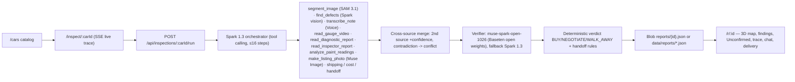

# Hanbridge Inspector

AI agent that runs the whole inspection of a used car in Korea for a buyer in Central Asia / CIS — from walk-around media to a verifiable report with a BUY / NEGOTIATE / WALK AWAY verdict.

Built for the **Meta Global AI Developer Hackathon** (Indie Developer track, Oct 26 – Nov 4, 2026).

## Why
A buyer in Almaty or Tashkent pays thousands of dollars for a car they have never seen. Trust breaks at the inspection: 40 WhatsApp photos, a paint-gauge readout and an auction sheet in Korean that the buyer cannot verify.

## What the agent does
1. Inspector uploads a walk-around video/photos, a voice note, the auction sheet photo and paint-gauge readings.
2. **SAM 3.1** segments panels, defects and license plates.
3. **Muse Voice Transcribe** turns the inspector's voice note into findings with timestamps.
4. **Muse Spark 1.3** orchestrates the tools, reads the Korean auction sheet and writes the verdict.
5. A separate verifier pass checks every finding against its evidence — no evidence, no finding.
6. **Muse Image** prepares a listing photo (plate hidden, background cleaned, vehicle pixels untouched).
7. Client gets one link `/r/:id` — every claim clicks through to the frame, mask, voice quote or gauge reading. EN/RU.

Low confidence → hand-off to a human manager. No invented customs/landed-cost numbers.

## Stack
Next.js (App Router) · TypeScript · Tailwind · Vercel · Vercel Blob · zod · sharp · Meta Model API (`muse-spark-1.3`, `sam-3.1`, `muse-voice-transcribe-1.0`, `muse-image-1.0`). Code written with **Muse Code**.

## Run locally
```bash
cp .env.example .env.local   # fill META_API_KEY
npm install
npm run dev
```

## Built during the hackathon
All code in this repository was written after the kickoff on 2026-10-26. Progress by task:
- [x] TZ-01 core + Spark expert — `tz-01` (merged)
- [x] TZ-02 SAM segmentation + defects — `tz-02` (merged)
- [x] TZ-03 voice + paint-gauge video → findings — `tz-03` (merged)
- [x] TZ-04 listing image (plate hidden, car-pixel diff guard) — `tz-04` (merged)
- [x] TZ-05 agent orchestrator + open-weight verifier + report `/r/:id` — branch `tz-05`
- [x] TZ-06 3D body map (parametric templates, 13 panels) — `tz-06` (merged)
- [x] TZ-08/09 journey scene (7 stages, 2.5D photo plates) — `tz-08`, `tz-09` (merged)

Reports with raw run output: `docs/reports/tz-01.md` … `tz-09.md`.

## Architecture (TZ-05)


| Meta model | Where used |
|---|---|
| `muse-spark-1.3` | Agent orchestrator (native tool calling), defect scan, voice/OBD/inspector extraction, verdict text, report chat |
| `sam-3.1` | `segment_image`, car crop for defects, plate box for listing |
| `muse-voice-transcribe-1.0` | `transcribe_note` (15 s chunks from any inspection video) |
| `muse-image-1.0` | Listing background edit (car-pixel diff guard) + report hero |
| `muse-spark-open-1026` (Baseten, open weights) | Independent verifier — only the finding + its evidence; fallback `muse-spark-1.3`, model written to trace |

## Assets
- **3D cars**: no third-party or AI-generated 3D models. The sedan / SUV / hatchback used in the 3D body map are generated in code at runtime (`src/components/damage-map-3d/buildCar.ts`), brand-neutral (no badges, logos or brand-specific grilles), written on 2026-10-28.
- Inspection evidence always uses the original inspection frames; the 3D car is a schematic body template, not a copy of the inspected vehicle.

## Pre-hackathon
Nothing from earlier projects is used here. Earlier Hanbridge prototypes (landing page, 3D showroom) live in separate repositories and are not part of this submission.

## License
MIT
