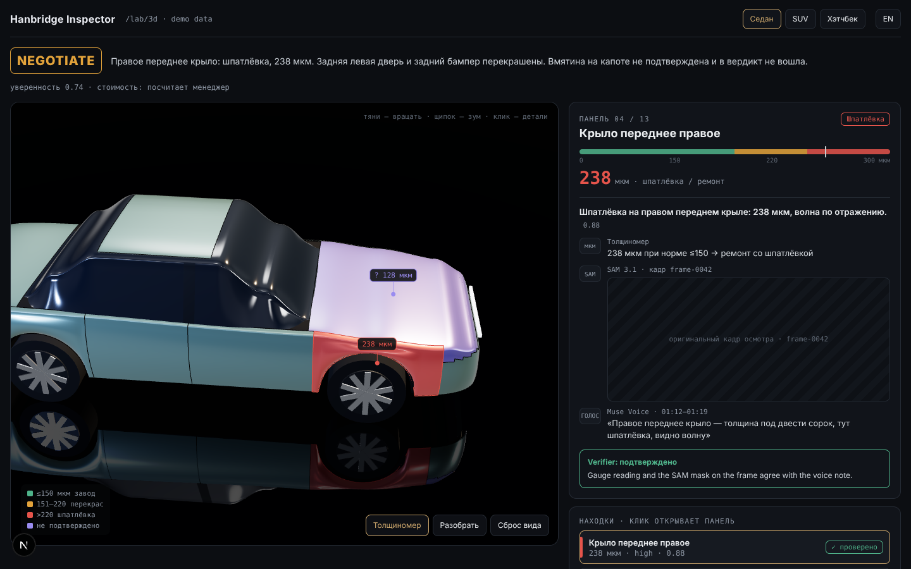
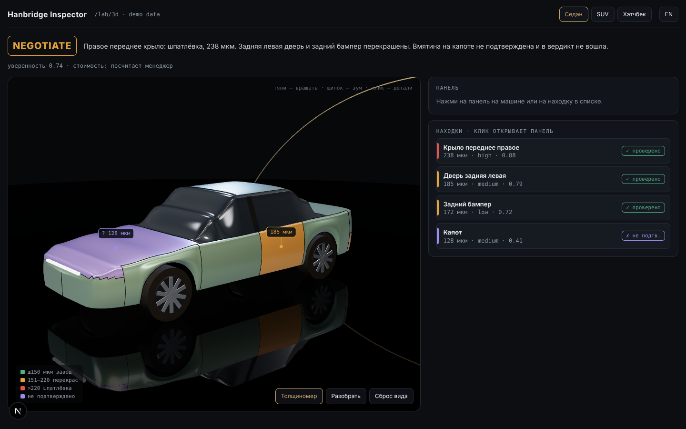
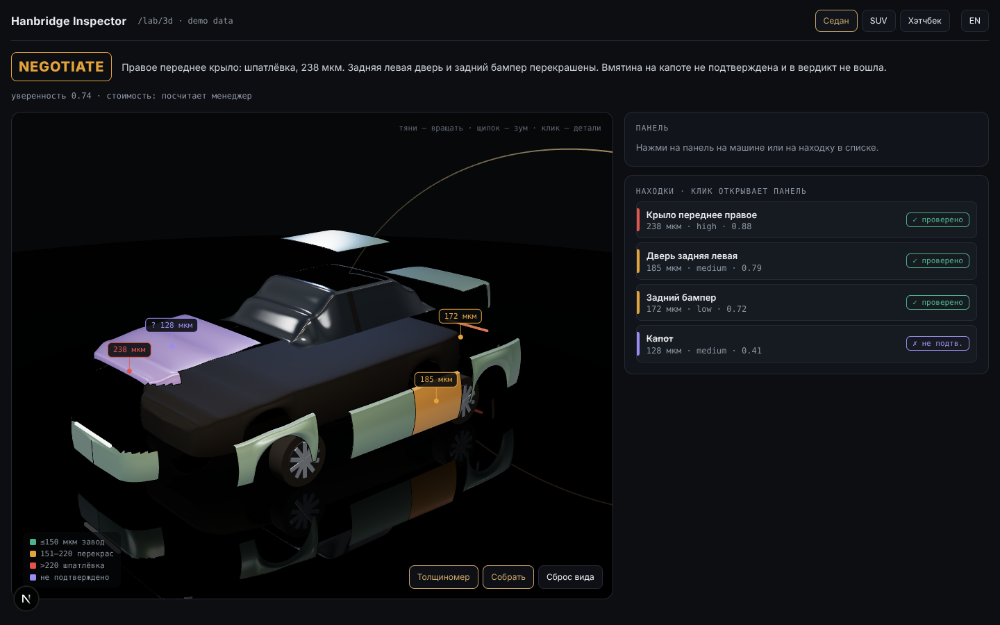
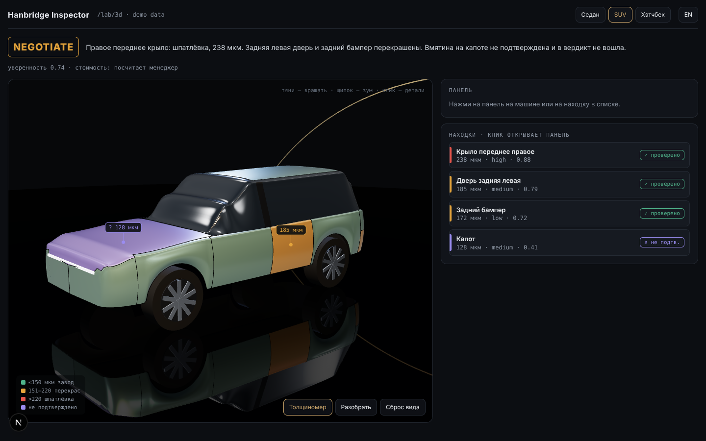
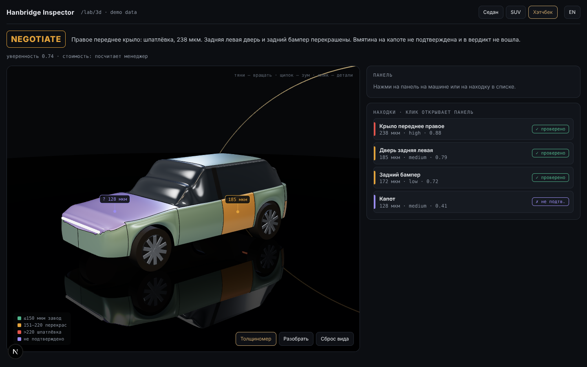
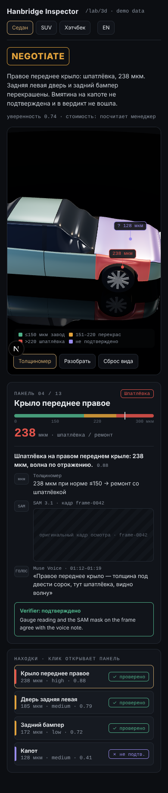
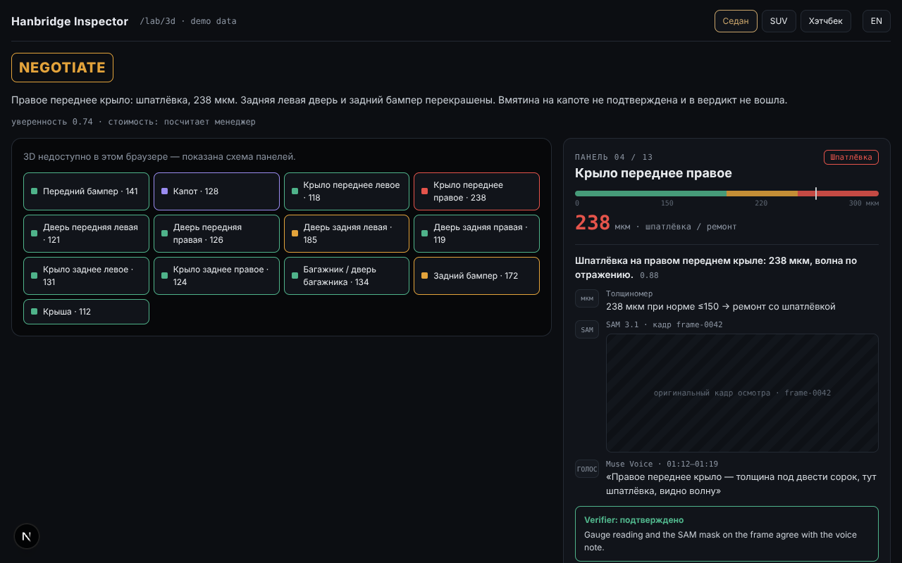

# TZ-06 report — 3D body map

Author: Claude (not Muse). Branch: `tz-06`. Date: 2026-10-28.

## Done
- Parametric brand-neutral car generator (sedan / SUV / hatchback, 3-door hatch variant), 13 panels with seams, glass, pillars, wheels, light bars, explode vectors.
- `DamageMap3D` (three.js scene in studio style), `PanelEvidence`, `InspectionMap` (drop-in block for `/r/:id`), `guessBodyType`, demo page `/lab/3d`.
- Schema: optional `vehicle.bodyType`, `vehicle.doors`.
- Details and how to plug into `/r/:id`: `docs/tz/06_3d_damage_map.md`.

## Files
```
 M README.md
 M package-lock.json
 M package.json
 M src/lib/schema/index.ts
?? docs/reports/assets/
?? docs/reports/tz-06.md
?? docs/tz/06_3d_damage_map.md
?? scripts/3d/
?? src/app/lab/
?? src/components/
```

## Raw output
### node --check
```
node --check scripts/3d/capture.mjs OK
```
### tsc
```
tsc: 0 errors
```
### lint
```

> hanbridge-inspector@0.1.0 lint
> eslint .

```
### vitest
```

 RUN  v3.2.7 /home/claude/hanbridge-inspector

 ✓ src/components/damage-map-3d/damageMap3d.test.ts (22 tests) 543ms
 ✓ src/lib/domain/paint.test.ts (10 tests) 10ms

 Test Files  2 passed (2)
      Tests  32 passed (32)
   Start at  19:00:31
   Duration  1.28s (transform 171ms, setup 0ms, collect 290ms, tests 553ms, environment 0ms, prepare 116ms)

```
### build
```

> hanbridge-inspector@0.1.0 build
> next build

   ▲ Next.js 15.5.28

   Creating an optimized production build ...
 ✓ Compiled successfully in 9.0s
   Linting and checking validity of types ...
   Collecting page data ...
   Generating static pages (0/7) ...
   Generating static pages (1/7) 
   Generating static pages (3/7) 
   Generating static pages (5/7) 
 ✓ Generating static pages (7/7)
   Finalizing page optimization ...
   Collecting build traces ...

Route (app)                                 Size  First Load JS
┌ ○ /                                      130 B         103 kB
├ ○ /_not-found                            990 B         104 kB
├ ƒ /api/expert/analyze                    130 B         103 kB
├ ƒ /api/expert/chat                       130 B         103 kB
└ ○ /lab/3d                              8.47 kB         111 kB
+ First Load JS shared by all             103 kB
  ├ chunks/255-b1e2483a7e02feee.js       46.6 kB
  ├ chunks/4bd1b696-c023c6e3521b1417.js  54.2 kB
  └ other shared chunks (total)          2.03 kB


○  (Static)   prerendered as static content
ƒ  (Dynamic)  server-rendered on demand

```
### Panel stats (vitest debug run, triangles per panel, sedan)
```
front_bumper 1106 · hood 3630 · front_l/r_fender 1936 · front_l/r_door 1892 · rear_l/r_door 1584 · rear_l/r_fender 2112 · trunk 2692 · rear_bumper 468 · roof 1600 · total model ≈62k tris
```
### capture.mjs (headless Chromium + SwiftShader)
```
first frame ms (headless swiftshader): 7480
saved tz06-sedan-selected / tz06-sedan-assembled / tz06-sedan-exploded / tz06-suv-assembled / tz06-hatchback-assembled / tz06-mobile
fallback grid buttons: 13
errors: []
```

## Screenshots
- 
- 
- 
- 
- 
- 
- 

## Not working / not checked
- FPS on a real GPU not measured (headless SwiftShader renders ~2 fps, not representative). Check on Vercel Preview on a laptop and a phone.
- Evidence frames are placeholders on `/lab/3d`: the demo report has no media in Blob. In `/r/:id` pass `mediaUrl`.
- Not yet wired into `/r/:id` (TZ-05 not merged).
- `scripts/3d/capture.mjs` needs `playwright` available (not added to package.json to keep the lockfile small).
