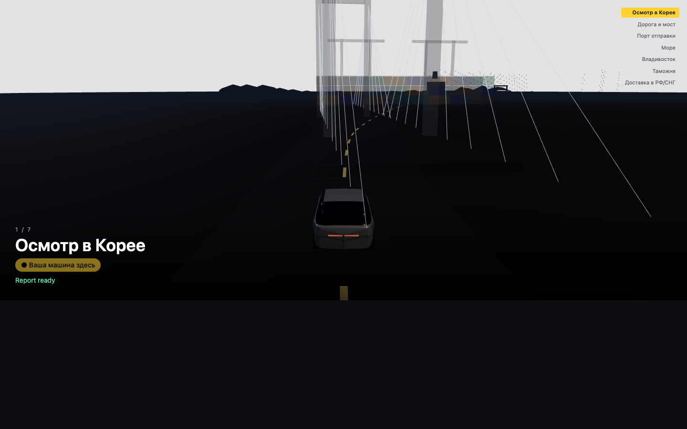
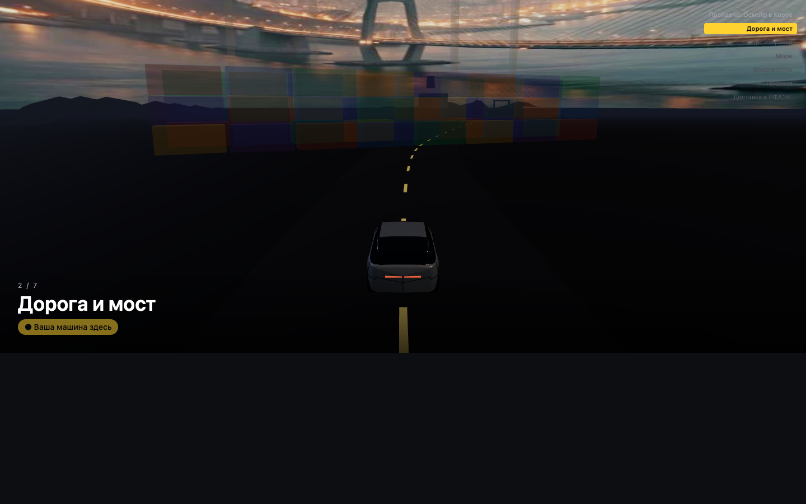
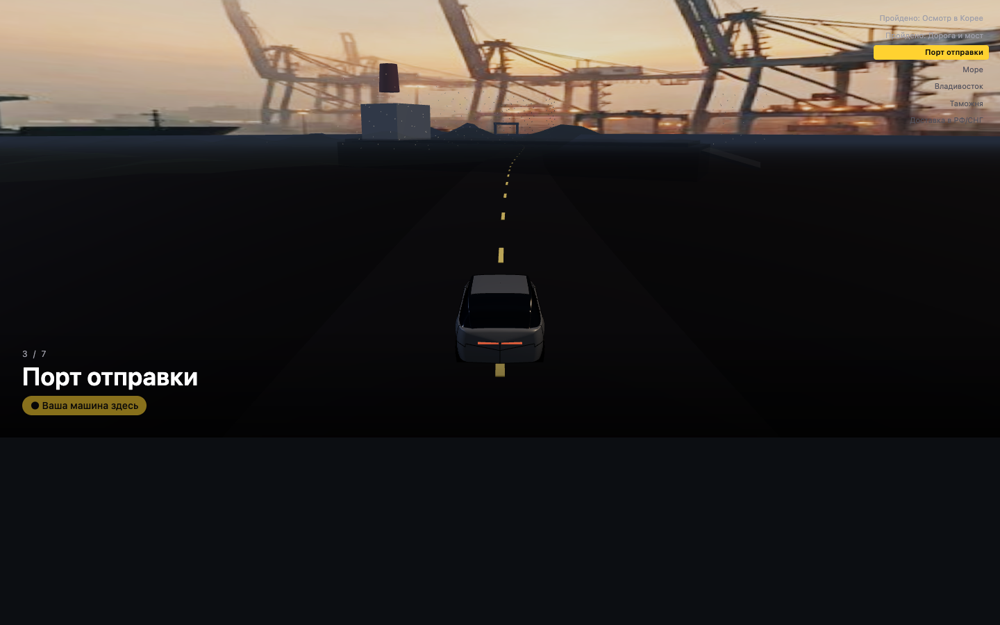
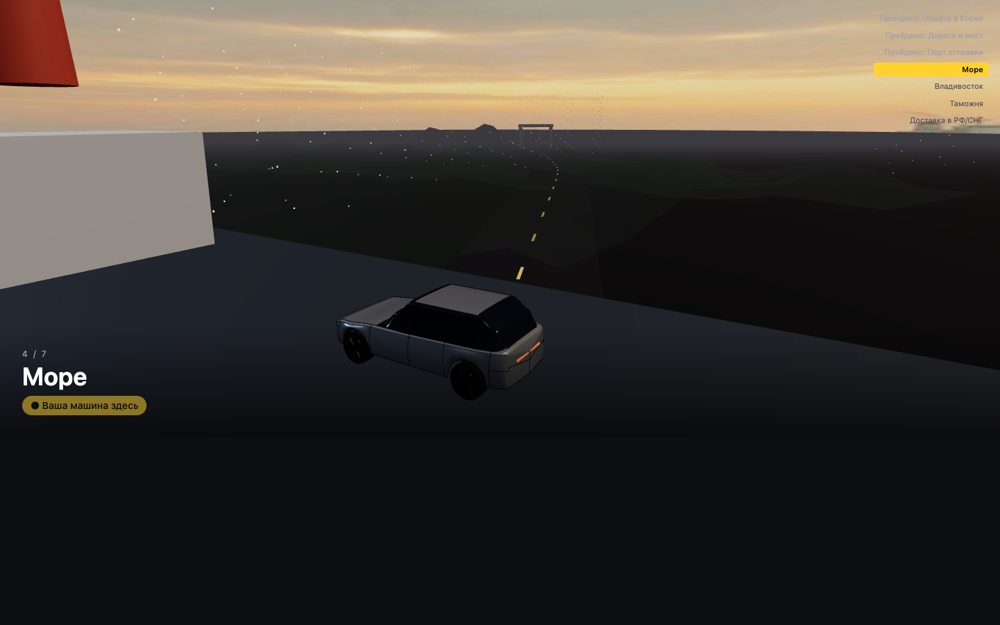
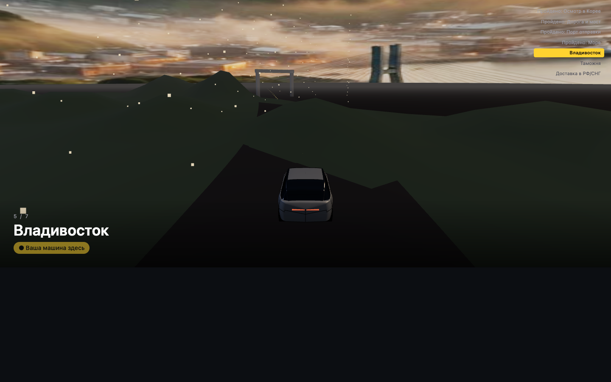
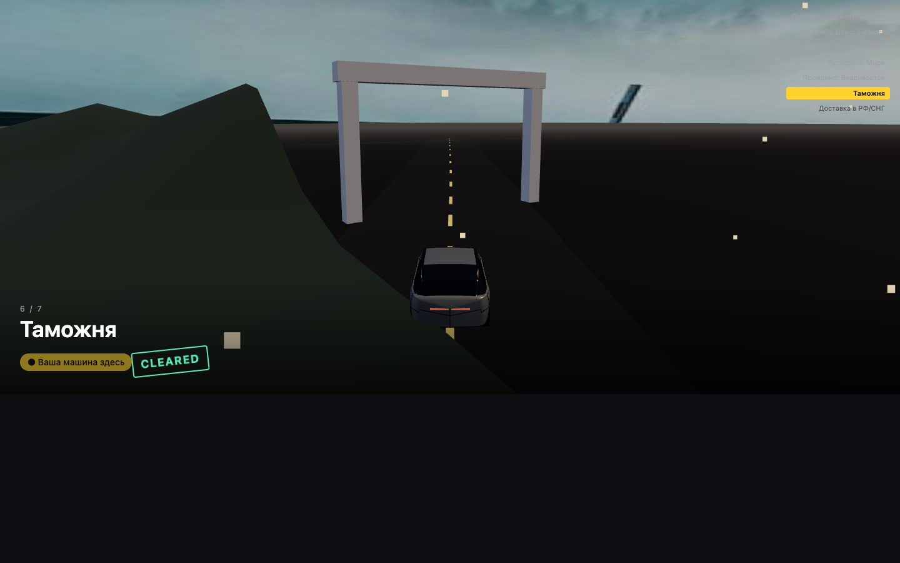
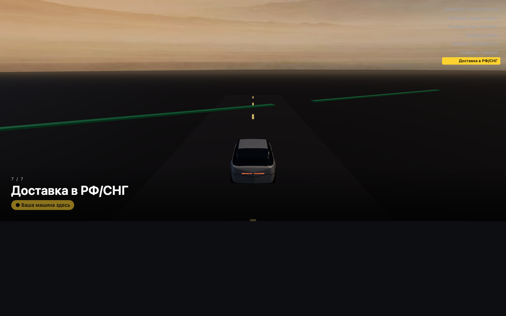
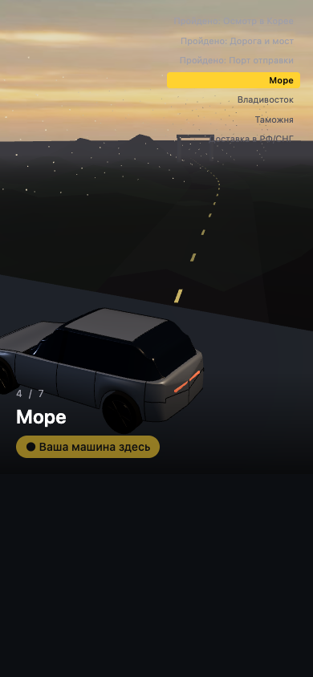
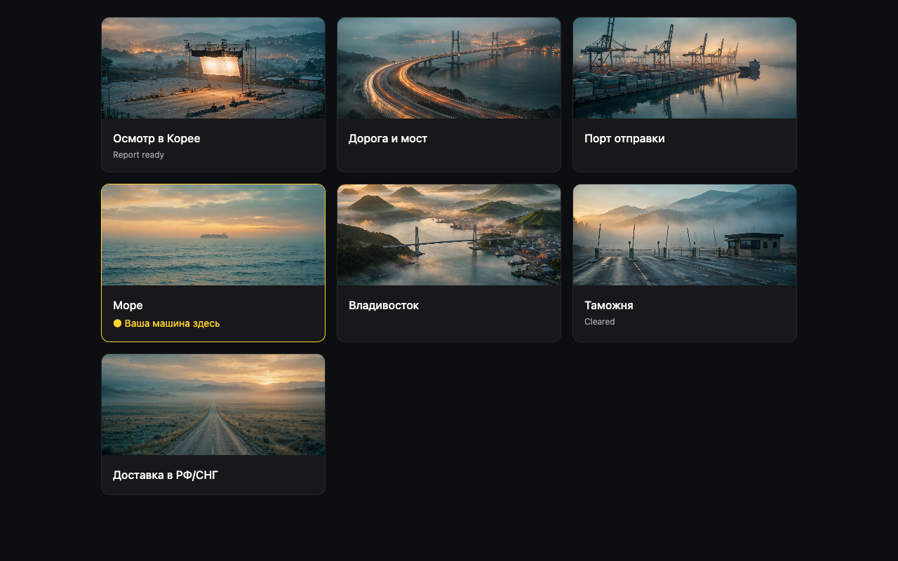

# TZ-08 report — Journey scene "The Car's Path"

Author: Muse Wonder (inside Muse Code, Meta's coding agent), agent ID `muse-code`. Branch: `tz-08` off `main`. Date: 2026-10-28. Not pushed — push is up to the reviewer.

## What was done
- `src/components/journey-3d/route.ts` — 7 fixed stages, `CatmullRomCurve3`, `stageAt`/`progressOf`/`progressCenterOf` (pure functions; boundaries and monotonicity covered by tests).
- `src/components/journey-3d/scenery.ts` — built in code: road ribbon with instanced markings, cable-stayed bridge (pylons + stays as `LineSegments`), port (cranes, `InstancedMesh` containers), ro-ro ship, water as `ShaderMaterial` (waves in the vertex shader + Fresnel mix), hills (noise heightfield), city lights (`Points`), pad with a softbox, customs gate.
- `src/components/journey-3d/JourneyScene.tsx` — `"use client"`: sticky section 700vh (mobile 500vh), scroll → progress → smoothed camera and car `buildCar(bodyType)` from TZ-06 (import only); on `sea` the car sits on the deck of a rocking ship; light/fog shift by stage from night to dawn; domes with textures `public/journey/<stage>.jpg` and cross-fade; stage HUD in RU/EN, "Report ready", "Cleared" stamp, "Your car is here" marker + pulse at `currentStage`; zones after the current one dimmed (opacity 0.32); eco mode (<40 FPS for 2 s → static water, pixelRatio 1); fallback without WebGL / `prefers-reduced-motion` / `?no3d=1` — ribbon of 7 cards.
- `scripts/journey/generate-backdrops.mjs` — 7 backgrounds via `muse-image-1.0`, single run, ≤1600px JPEG q80, provenance in `public/journey/prompts.json`.
- `src/lib/agent/tools/shipping.ts` + `fixtures/shipping.json` — `getShippingStatus(reportId)` → `{stage, etaDays?, source:"demo_fixture"}`, 5 demo cars at different stages; unknown id → `inspection` with no invented date.
- Home `/` — hero `JourneyHero` (hatchback, no `currentStage`) + "Inspection catalog" button → `/cars`; `/lab/journey?stage=&body=&lang=` (dev/Preview, production 404); `compact+currentStage` export for the "Delivery" tab of TZ-05.
- `scripts/journey/capture.mjs` — screenshots of stages / mobile / fallback (`CHROMIUM_PATH` — optional path to a local Chromium).

## Files (@agent: muse-code on all created files)
```
public/journey/{inspection,korea_road,port_busan,sea,vladivostok,customs,delivery}.jpg, prompts.json
scripts/journey/{generate-backdrops,capture}.mjs
src/components/journey-3d/{route,scenery,JourneyScene,JourneyHero}.tsx/ts, journey.test.ts
src/lib/agent/tools/shipping.ts, src/lib/agent/fixtures/shipping.json (+ .agent.md)
src/app/page.tsx, src/app/lab/journey/{page,LabJourneyClient}.tsx
docs/reports/assets/tz08-*.png, docs/reports/tz-08.md
```
TZ-06 files were not changed (only the `buildCar`/`BodyType` imports).

## Raw output

### generate-backdrops.mjs (single run)
```
inspection.jpg saved in 21433ms
korea_road.jpg saved in 10654ms
port_busan.jpg saved in 26730ms
sea.jpg saved in 8501ms
vladivostok.jpg saved in 17666ms
customs.jpg saved in 9936ms
delivery.jpg saved in 10467ms
prompts.json saved
```
Size of `public/journey/`: `1.1M` total (≤3 MB): 130–185 KB per stage + prompts.json 3.4 KB.

### node --check / tsc / lint / vitest
```
== node --check ==
OK
== tsc ==
tsc: 0 errors
== lint ==
> hanbridge-inspector@0.1.0 lint
> eslint .
== vitest ==
 ✓ src/lib/domain/paint.test.ts (10 tests)
stdout | journey.test.ts > triangle budget
scenery=8258 car=25388 total=33646
 ✓ src/components/journey-3d/journey.test.ts (5 tests)
 ✓ src/lib/meta/sam.test.ts (5 tests)
 ✓ src/lib/agent/tools/segment.test.ts (5 tests)
 ✓ src/components/damage-map-3d/damageMap3d.test.ts (22 tests)
 Test Files  5 passed (5)
      Tests  47 passed (47)
```
Scene triangles: **33 646** (scenery 8 258 + car 25 388 with `stations: 80`) out of a budget of 250 000.

### build
```
 ✓ Compiled successfully
 ✓ Generating static pages (8/8)
Route (app)                                 Size  First Load JS
┌ ○ /                                    1.88 kB         105 kB
├ ƒ /api/expert/analyze                    123 B         103 kB
├ ƒ /api/expert/chat                       123 B         103 kB
├ ○ /lab/3d                              8.41 kB         111 kB
└ ƒ /lab/journey                         1.48 kB         104 kB
```

### capture.mjs (headless Chromium SwiftShader, `next start -p 3100`)
```
saved tz08-inspection / tz08-korea_road / tz08-port_busan / tz08-sea /
      tz08-vladivostok / tz08-customs / tz08-delivery / tz08-mobile
fallback cards: 7
saved tz08-fallback
page errors: []
```

## Screenshots
- 
- 
- 
- 
- 
- 
- 
- 
- 

## Not working / not verified
- Did not measure FPS on a real GPU (headless SwiftShader is not representative); the eco threshold of <40 FPS for 2 s is implemented in code.
- Scroll-through on the home page was checked only via frames of `/lab/journey?stage=`; the full 25-second scroll for video is for Arthur to check on Preview.
- On the `inspection` stage the camera looks along the route: the next stage's bridge is visible ahead (the scene is unified, zones are not hidden).
- `/cars` does not exist yet (TZ-05) — the hero button points to a future route.

## Commits (tz-08)
```
237d8c3 feat(journey): route, scenery, shipping fixture, Muse Image backdrops (TZ-08)
844aac8 feat(journey): JourneyScene scroll scene, homepage hero, /lab/journey (TZ-08)
8cb97f8 feat(journey): capture script, stage screenshots, framing fixes (TZ-08)
+ final commit: mobile HUD fix, report, CONTEXT/PROJECT-STATUS
```
