<!-- @agent: muse-code · @project: hanbridge-inspector · @purpose: отчёт ТЗ-09 шлифовка сцены пути и длинные биты этапов · @created: 2026-10-29 -->
# TZ-09 report — Journey polish (2.5D plates, beats, stage content)

Author: Muse Code (`muse-code`). Branch: `tz-09` от `main`. Date: 2026-10-29. Не запушено — пуш за ревьюером.

## Что сделано

### Часть A — кадр
- Не-compact: sticky-контейнер ровно `100svh`, канвас на весь кадр; секция 1400vh (моб. 1000vh). `/lab/journey` рендерит только не-compact (`?stage=&beat=` скроллит к нужному биту). `compact` — как было (70vh).
- Куполы убраны. Фон этапа — DOM-фото на весь экран (`object-cover`), кросс-фейд 0.6 с (два слоя), параллакс ±2.5% от прогресса внутри этапа. Canvas прозрачный поверх.
- Туман: цвет = средний цвет нижних 10% фото этапа (считается в браузере при загрузке), земля — неосвещённая плоскость того же цвета; вода получила тот же fog в шейдере (uniform `uFogColor/uFogNear/uFogFar`).
- Передний план только активного этапа (остальные зоны скрыты, генераторы не удалены):
  - `inspection`: глянцевый пол (roughness 0.35), два emissive-софтбокса над машиной, бейдж «Report ready»;
  - `korea_road`: только дорога к горизонту фото; мост 3D скрыт (он на фото), контейнеры убраны этим же механизмом;
  - `port_busan`: контейнеры — 2 ряда на земле рядом с дорогой (непрозрачные, castShadow), краны унесены вглубь;
  - `sea`: вода-шейдер до горизонта (земля на этом этапе скрыта, дорога скрыта), тёмный корпус ro-ro + белая надстройка позади машины, машина на палубе, качка камеры; белый куб/красный цилиндр заменены надстройкой с тёмной полосой и тёмной трубой;
  - `vladivostok`: 3D-сопки и городские огни скрыты (спорили с фото-горной пластиной; ТЗ это разрешает), дорога + туман;
  - `customs`: ворота + штамп «Cleared»; `delivery`: дорога + туман (тонкие боковые полосы скрыты — читались как артефакты).
- Машина: rim-light по цвету неба этапа, контактная тень (radial-gradient plane под машиной), солнечная тень (PCFSoft, sun следует за машиной), bloom `UnrealBloomPass` на фары/стопы/софтбоксы; eco (<40 FPS за 2 с) выключает composer, воду-шейдер и ставит pixelRatio 1.
- Подписи: правый список этапов на подложке `bg-black/40 backdrop-blur`, заголовок этапа слева внизу, машину не перекрывает.

### Часть B — длина и информация
- `route.ts`: чистая `beatAt(progress) → {stage, beat: 0|1|2, local}`; `stageAt`/`progressOf` не тронуты. Секция 1400vh/1000vh ≈ 2 экрана на этап: при 900px вьюпорте полный скролл = 14×900 ≈ 12 600px ≈ 50–60 с в темпе записи видео (оценка ТЗ по высоте секции).
- `stageContent.ts`: RU/EN по всем 7 этапам (что происходит / документы / кто отвечает / что видит клиент / обычно). Сроки — дословно из ТЗ; цен и сумм нет (тест сторожит отсутствие ₽/руб/USD/$ рядом с цифрами и точные строки `typical`). Итог под прогресс-баром: «После оплаты до Москвы — примерно 4–5 недель».
- Бит 1 — стеклянная карточка слева (все 5 полей), машину не перекрывает. Бит 2 — доказательство: `inspection` — 4 миниатюры `public/journey/proof/inspection-*.jpg` (+ счётчик только при prop `reportSummary`, в lab не передаётся — выдуманных цифр не ставим); `port_busan`/`vladivostok` — чек «Фотофиксация состояния»; `customs` — анимированный чек-лист (СБКТС/ЭПТС → декларация → Cleared по шагам бита). Прогресс справа: три точки битов под активным этапом, клик по этапу — плавный скролл к его началу.
- Фолбэк без WebGL / `prefers-reduced-motion`: те же тексты из `stageContent.ts` в карточках + итоговая строка.

### Proof-фото (проверка глазами выполнена)
4 фото MINI из `demo-data/mini-cooper-s/photos/`; SAM `license plate` (живой вызов, как в `segmentImage`); фото без найденного номера не бралось (`photo_243116_0.jpg` — 0 боксов, пропущено). Все найденные боксы (на заднем плане тоже — на `inspection-3` 5 боксов) закрыты мозаикой попиксельно в raw-буфере sharp. Итог глазами: ни на одном из 4 фото читаемого номера нет (свой номер закрыт полностью, фоновые — мозаикой/масштабом).
Замечание по инструменту: `sharp.composite()` с JPEG/PNG-патчами на этих файлах ложился со сдвигом и масштабом ≈×1.9 (воспроизведено изолированно), поэтому мозаика сделана прямо в raw-пикселях — координаты SAM при этом точные (контроль красной рамкой по боксу лёг пиксель-в-пиксель на номер).

## Файлы (@agent: muse-code)
```
src/components/journey-3d/{JourneyScene,scenery,route,stageContent,journey.test}.ts(x)
src/app/lab/journey/{page,LabJourneyClient}.tsx
scripts/journey/capture.mjs
public/journey/proof/inspection-{1..4}.jpg
docs/reports/assets/tz09-*.png, docs/reports/tz-09.md
```
`git diff --stat main..HEAD`: только разрешённые файлы (+ proof/, stageContent.ts, отчёт/скриншоты). Размер `public/journey/` без proof не изменился: 7 jpg 133–189 КБ + prompts.json 3432 Б (как в ТЗ-08); proof/ — +340 КБ.

## Сырой вывод

### tsc / lint / node --check
```
$ npx tsc --noEmit        → 0 errors (вывод пуст)
$ npm run lint            → eslint . (0 errors, 0 warnings)
$ node --check scripts/journey/capture.mjs → NODE_CHECK_OK
```

### vitest
```
scenery=7826 car=25388 total=33214
 ✓ src/lib/domain/paint.test.ts (10 tests)
 ✓ src/lib/meta/sam.test.ts (5 tests)
 ✓ src/lib/agent/tools/segment.test.ts (5 tests)
 ✓ src/components/journey-3d/journey.test.ts (8 tests)
 ✓ src/components/damage-map-3d/damageMap3d.test.ts (22 tests)
 Test Files  5 passed (5)
      Tests  50 passed (50)
```
Треугольники сцены: **33 214** из бюджета 250 000. Тесты `beatAt`: границы/клампы, все 21 бит достижимы, монотонность по 2101 точке, согласованность со `stageAt`; старые тесты не правились (добавлены новые).

### build
```
 ✓ Compiled successfully
 ✓ Generating static pages (8/8)
Route (app)                                 Size  First Load JS
┌ ○ /                                    1.89 kB         105 kB
├ ƒ /api/expert/analyze                    123 B         103 kB
├ ƒ /api/expert/chat                       123 B         103 kB
├ ○ /lab/3d                              8.41 kB         111 kB
└ ƒ /lab/journey                         128 kB         231 kB
```
(Рост чанка lab/journey — postprocessing bloom; главная грузит JourneyScene динамически.)

### capture.mjs (headless Chromium SwiftShader, `next start -p 3100`)
```
saved tz09-inspection / korea_road / port_busan / sea / vladivostok / customs / delivery
saved tz09-<stage>-info ×7
saved tz09-mobile
fallback cards: 7
saved tz09-fallback
page errors: []
```

## До / после

### sea
До: машина на серой плоскости, белый куб и красный цилиндр слева, моря и корабля нет, канвас ~70% высоты.
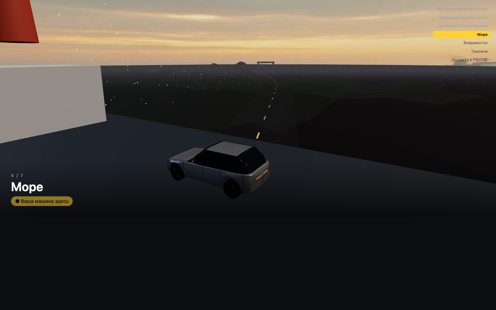
После: фото рассвета на весь кадр, машина на тёмной палубе, белая надстройка позади, море-шейдер до горизонта, список этапов читаем на подложке.
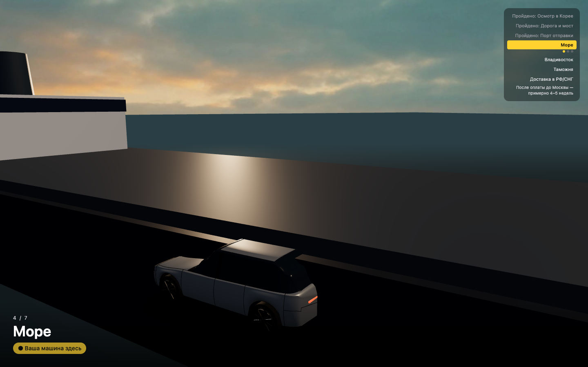

### korea_road
До: контейнеры висят полупрозрачными прямоугольниками в небе перед мостом.
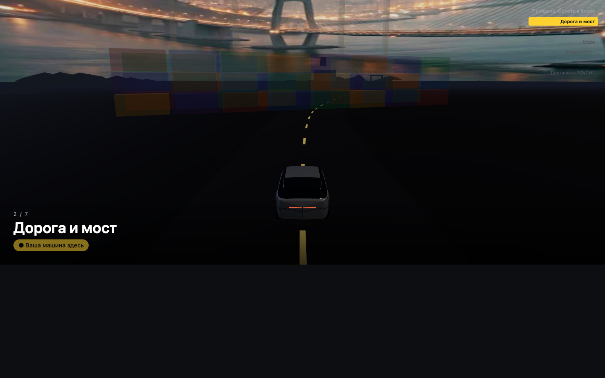
После: мост только на фото, перед машиной — только дорога с разметкой к горизонту.
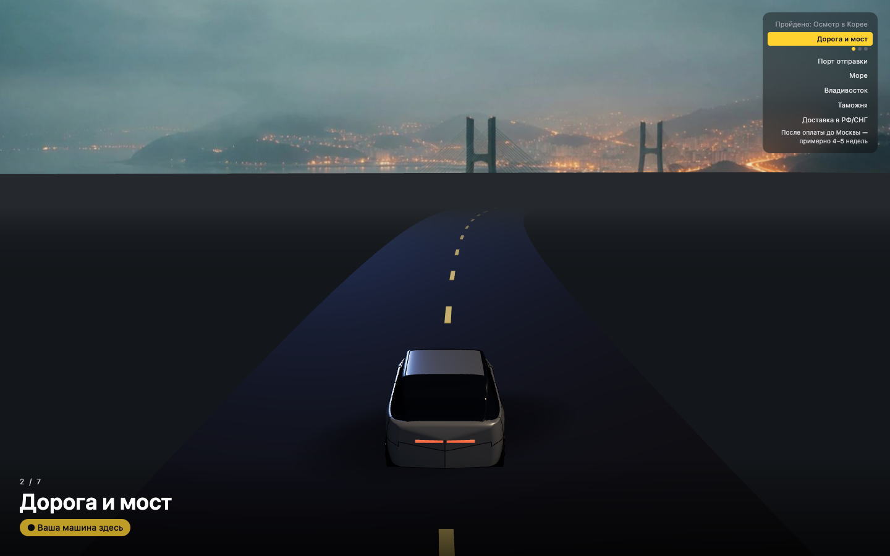

## Скриншоты
- 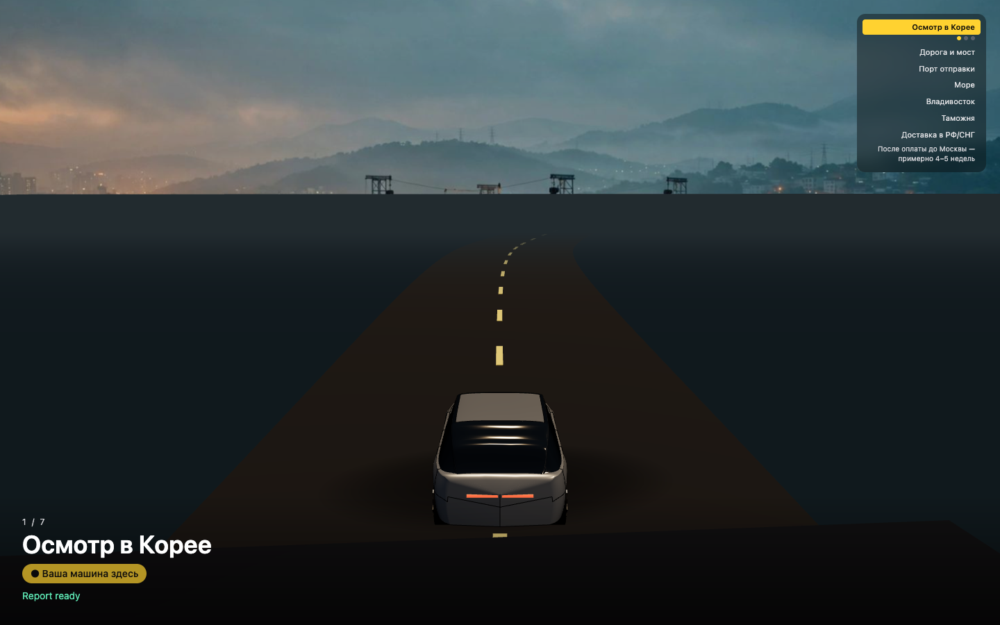
- 
- 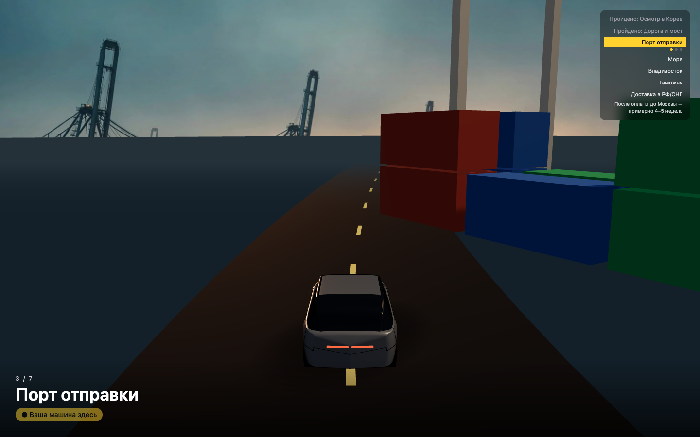
- 
- 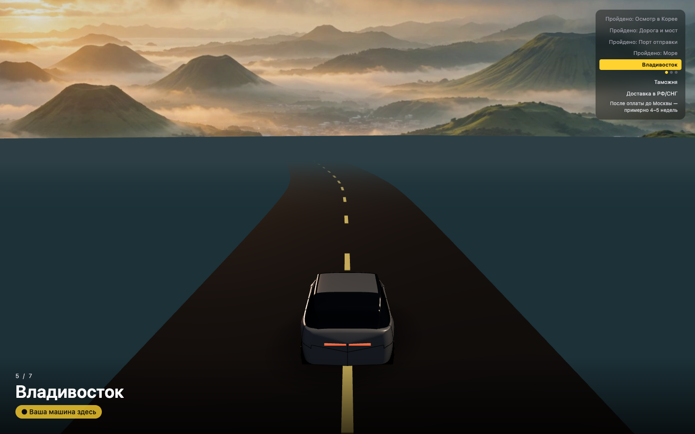
- 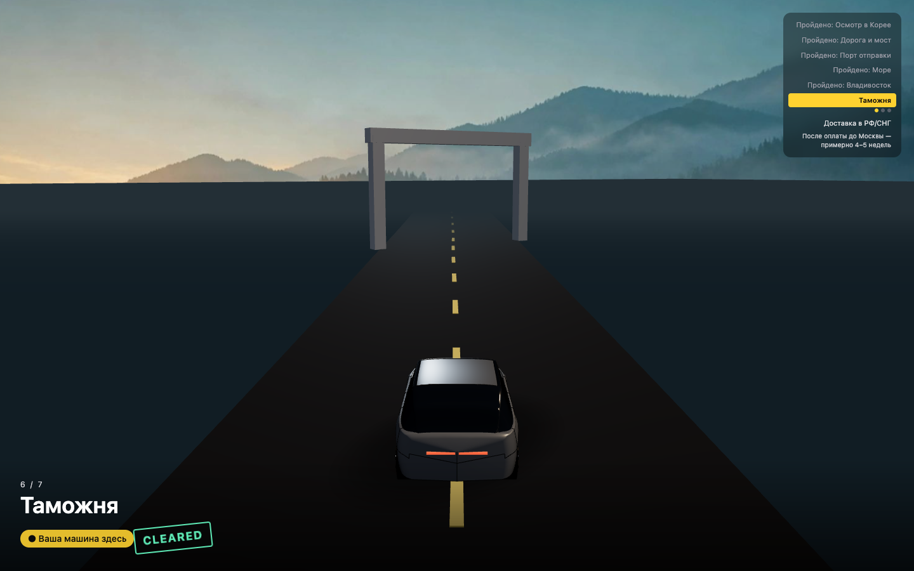
- 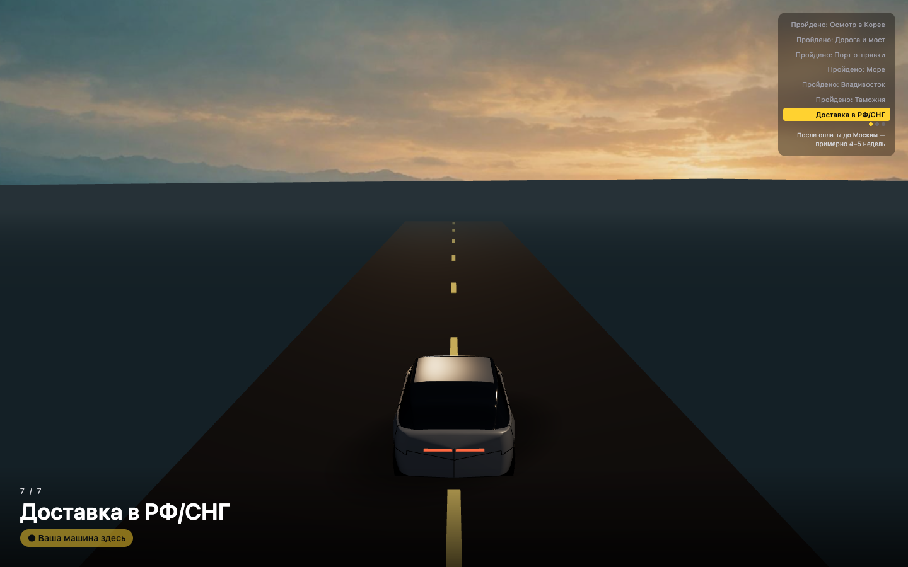
- Биты 1 (инфо-карточка): `tz09-<stage>-info.png` ×7, напр. 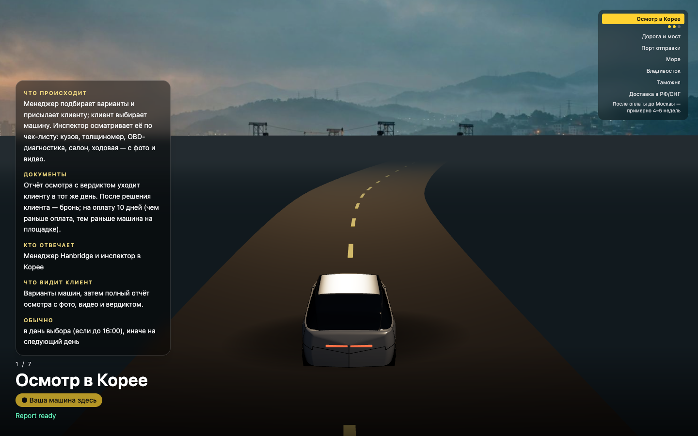
- 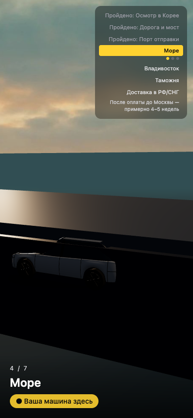
- 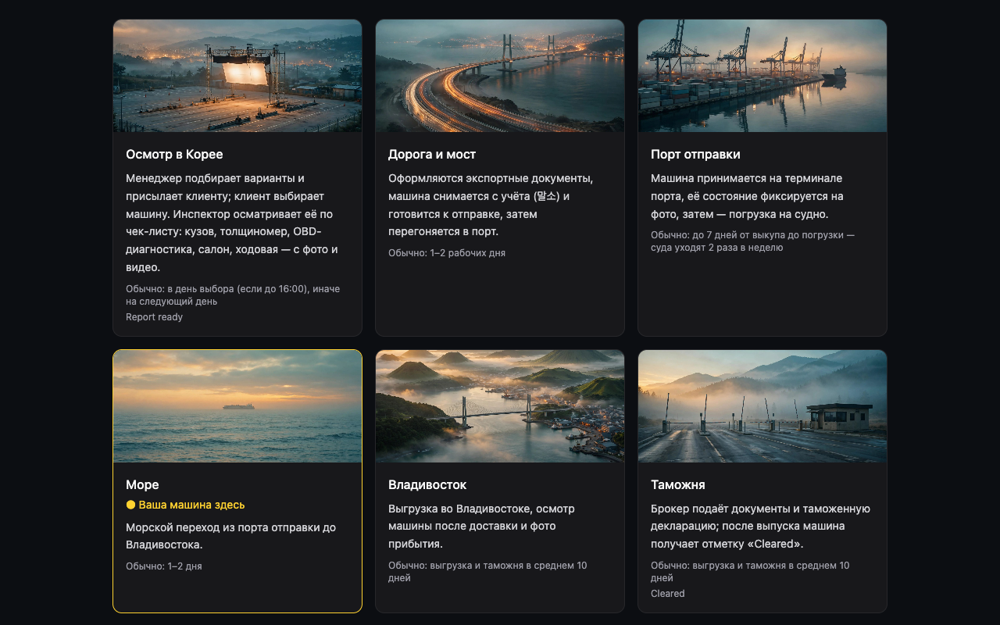

На каждом этапе: канвас на весь кадр, висящих в воздухе объектов нет, горизонт закрыт туманом цвета низа фото (видимой склейки нет; на `vladivostok`/`inspection` линия горизонта фото читается как дальняя равнина — геометрия её не режет).

## Не работает / не проверено
- FPS на реальном GPU не мерян (headless SwiftShader); eco-порог в коде, на съёмке `data-eco` не выставлялся.
- Полный 50–60-секундный скролл для видео не записывал — кадры сняты прыжками `?stage=&beat=` по тому же скролл-пути; плавность переходов битов на Preview — за Артуром.
- Счётчик находок на бите 2 `inspection` ждёт реальный `reportSummary` от ТЗ-05; без prop показываются только миниатюры.
- Горизонт фото не ровно на 40% на всех пластинах (фоны ТЗ-08 разные); стык закрыт туманом, а не геометрическим совпадением горизонтов.

## Коммиты (tz-09)
```
91239ac feat(journey): beatAt progress beats + stageContent RU/EN (TZ-09B)
79e3285 feat(journey): 2.5D plates, per-stage foreground, beats HUD, proof photos (TZ-09)
ff97181 fix(journey): hide arguing geometry, softboxes over car, water fog (TZ-09)
+ финальный: скриншоты, отчёт, CONTEXT/PROJECT-STATUS
```
